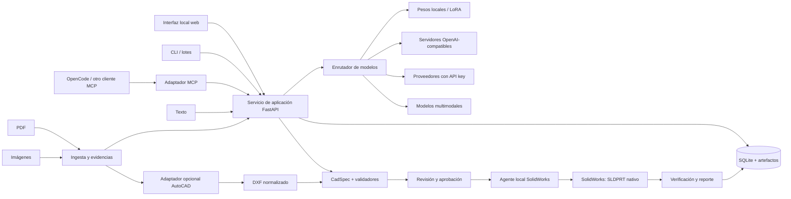
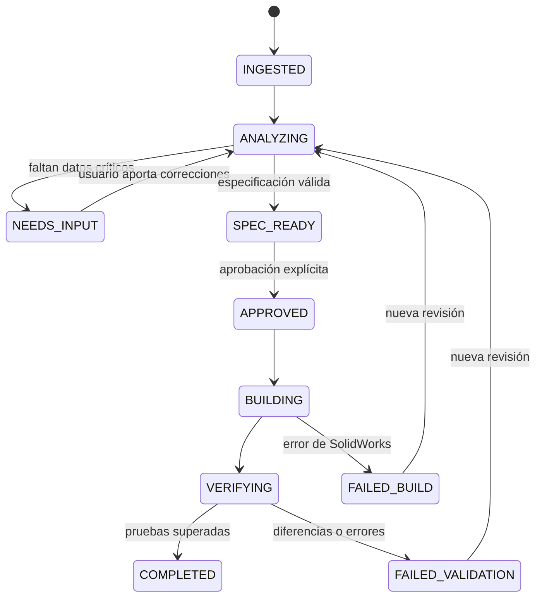

# Arquitectura propuesta

## 1. Visión

AUTOSOLID será una aplicación local para Windows con cuatro puntos de entrada: interfaz de revisión, API local, MCP y automatización por lotes. Todos ejecutan el mismo caso de uso y comparten proyectos, artefactos y validaciones.



## 2. Límites de responsabilidad

### Interfaz local

La interfaz mínima actual (tareas 005–008) es HTML, CSS y JavaScript sin build, servida por FastAPI, sin Node, bundler, CDN ni recursos externos. React + TypeScript sigue siendo una opción para cuando la vista de fuentes, evidencias y previsualización 3D justifique el toolchain; no se añadió en esta iteración. No se añade Electron/Tauri hasta que exista una necesidad demostrada.

La vista principal tendrá cuatro zonas:

1. **Fuente:** PDF/imagen con zoom, páginas, vistas y resaltado de evidencias.
2. **Interpretación:** vistas detectadas, escala, cotas, supuestos e incógnitas.
3. **Diseño:** árbol de operaciones y editor de parámetros/croquis.
4. **Resultado:** previsualización 3D, comparación con las vistas y reporte de validación.

Estado actual: la pantalla cubre proyectos, editor JSON de `CadSpec`, validación, guardado, diagnósticos, preguntas, visor, un panel de fuentes con carga, listado, descarga y referencia manual al editor, y un panel de aprobación de diseño con revisor, confirmación, estado vigente/obsoleto e historial. La zona de fuente todavía no muestra el documento, sus páginas ni evidencias resaltadas; el resultado 3D y la UI de aprobación/construcción tampoco existen y no se simulan. La API de construcción existe desde la tarea 012, pero la interfaz no la consume. Los recursos se sirven con CSP restrictiva y el servidor escucha en loopback por defecto.

Cuando exista, la acción `Construir en SolidWorks` permanecerá deshabilitada si existen errores o ambigüedades críticas. Toda corrección humana se guarda como un nuevo evento, sin sobrescribir la evidencia original.

### Servicio de aplicación

Python y FastAPI, con modelos Pydantic para los contratos. Orquesta trabajos, versiones, proveedores, validación y aprobaciones. El dominio CAD no depende de FastAPI ni del SDK de MCP para poder probarlo de forma aislada.

SQLite conserva proyectos, estados, configuraciones no secretas y metadatos. Los PDF, imágenes, JSON, DXF, STEP, reportes y SLDPRT se guardan como artefactos content-addressed o con identificadores inmutables.

Estado de implementación (tareas 006, 008, 009 y 012): los PDF, imágenes y textos UTF-8 subidos se guardan por SHA-256 en `AUTOSOLID_DATA_DIR/artifacts/` y se indexan en SQLite v5. Hay deduplicación por proyecto, límite de 20 MiB y lectura con verificación de integridad. El MIME se deriva por fuente y no por el primer proyecto que cargó el blob. Las aprobaciones de diseño se guardan en una tabla append-only con triggers de inmutabilidad y clave única `(proyecto, revisión, alcance)`; su estado se calcula en una instantánea coherente contra la revisión vigente. Las aprobaciones de construcción viven en `build_approvals`, también append-only, con destino y expiración; `build_consumptions` y `build_jobs` registran el consumo único y los estados `queued/running/completed/failed`. Todavía no se guardan `DrawingSpec`, DXF, STEP ni reportes, y no existe recolector de blobs huérfanos. Los SLDPRT se quedan en el directorio de salida configurado y el trabajo guarda su nombre, SHA-256 y tamaño, no una copia content-addressed.

### Adaptador MCP

Servidor MCP local, preferiblemente `stdio` para OpenCode. Expone herramientas pequeñas y con esquemas estrictos; no duplica reglas del dominio.

MCP se elige porque es una interfaz estándar para clientes compatibles y OpenCode admite servidores locales y remotos. No sustituye la interfaz gráfica ni el servicio de aplicación.

Estado de implementación (tareas 003, 007 y 008): hay once herramientas de solo lectura o escritura controlada sobre proyectos, revisiones, fuentes y aprobaciones. Las herramientas `autosolid_source_*` listan metadatos y leen texto UTF-8; no suben archivos, no devuelven PDF/imágenes y no interpretan el contenido. El texto de una fuente se considera dato no confiable y se limita por caracteres. `autosolid_approval_list` y `autosolid_approval_get` solo consultan aprobaciones; no existe herramienta MCP para aprobar, revocar o consumir.

### Agente SolidWorks

Proceso Windows aislado en C#, usando la API COM oficial de SolidWorks/Interop. Se comunica con el backend mediante un proceso local, argumentos fijos y una cola de trabajos.

- Serializa las operaciones sobre una sesión de SolidWorks.
- Crea documentos nuevos por defecto; nunca sobrescribe el original sin autorización.
- Construye croquis, referencias y operaciones nativas editables.
- Captura errores de API, advertencias de reconstrucción y estado del árbol.
- Exporta reportes y artefactos de comprobación.
- Usa una versión de .NET y de Interop fijada tras probar la versión real de SolidWorks en la iteración 0.

El agente no contiene prompts ni llama a modelos. Recibe un `CadSpec` validado y una ruta de salida nueva; la autorización se comprueba antes, en el servicio.

Estado de implementación (tarea 012): Python lanza el ejecutable C# con `subprocess` sin shell, argumentos fijos y timeout, y valida el JSON de stdout antes de publicar el `.sldprt`. La cola es serial por proceso y la aprobación de construcción (`build`) se consume de forma atómica en SQLite. El agente sigue sin aprobar, sin decidir destinos y sin acceso a modelos. No hay canal remoto autenticado todavía; el ejecutable es local. El primer trabajo real verificado terminó `completed` con SolidWorks 2024 (`32.0.1`).

### Enrutador de modelos

Contrato único para completar texto, emitir JSON estructurado y analizar imágenes. Cada capacidad se configura por separado: `planner`, `vision`, `ocr_assist` y `repair`.

Adaptadores previstos:

- API OpenAI-compatible configurable (`base_url`, nombre de modelo y credencial).
- Proveedor nativo cuando sus funciones sean necesarias.
- Runtime local compatible con los pesos disponibles; la elección entre llama.cpp, vLLM, Transformers u otro depende del formato real y del hardware.
- Modelo multimodal independiente si las líneas de lenguaje no aceptan imágenes.

Cada respuesta registra proveedor, modelo, revisión/adaptador, parámetros, plantilla de prompt, tokens, latencia y hash de la entrada. No se guardan secretos en el historial.

Estado de implementación (tarea 004): existen el contrato de completion y el adaptador OpenAI-compatible descritos en [`README.md`](../README.md#proveedores-de-modelos). Todavía no hay enrutamiento por capacidad, selección de modelo, integración con la aplicación ni registro de prompts/hash. El proveedor simulado cubre pruebas locales.

**OpenCode:** cuando sea el cliente MCP, su propio modelo —incluido uno gratuito disponible allí— puede llamar a las herramientas AUTOSOLID. Esto no implica que esos modelos sean reutilizables como API dentro de la interfaz; para eso se necesita un proveedor directo o local.

## 3. Pipeline de PDF

Estado de implementación (tarea 006): el paso 1 existe de forma parcial —se calcula el hash y se conserva el original—, pero no hay detección de páginas, extracción de texto/vectores, rasterizado, segmentación, asociación de cotas ni cálculo de escala. Los pasos 2–10 de la ruta A siguen siendo objetivos.

### Ruta A: extracción propia, preferente para PDF vectorial

1. Calcular hash y conservar el original.
2. Detectar páginas, texto embebido, imágenes y operadores vectoriales.
3. Extraer líneas, curvas, arcos aproximables, textos y transformaciones con PyMuPDF u otra biblioteca validada.
4. Rasterizar una copia únicamente para visualización, OCR o contexto del modelo de visión.
5. Normalizar coordenadas, unidades de página y transformaciones.
6. Segmentar vistas, cotas, símbolos, cajetín y notas.
7. Asociar textos de cota con sus líneas de extensión y geometría.
8. Calcular escala por vista a partir de cotas conocidas.
9. Producir `DrawingSpec`, evidencias y una lista de ambigüedades.
10. Inferir operaciones candidatas y convertirlas a `CadSpec` mediante reglas + modelo.

La vectorización de un escaneo es una ruta distinta: segmentación/OCR/OpenCV y ajuste geométrico. No se presenta como equivalente al PDF vectorial y exige más revisión.

### Ruta B: AutoCAD como extractor opcional

Automatizar con .NET/COM o la API admitida por la versión instalada, evitando clics y coordenadas de pantalla.

1. Abrir un DWG temporal aislado.
2. Ejecutar `PDFATTACH` para la página indicada.
3. Ejecutar `PDFIMPORT` seleccionando el subrayado/objeto y opciones de importación documentadas.
4. Ejecutar `PDFDETACH` después de obtener geometría editable.
5. Explorar entidades, capas, textos y bloques; no confiar solo en una captura.
6. Escalar con `SCALE` por referencia o matriz calculada.
7. Validar al menos una segunda cota independiente.
8. Exportar DXF/DWG y convertir al `DrawingSpec` común.

El nombre exacto de comandos, opciones y automatización se comprobará contra la versión instalada. AutoCAD no será obligatorio si la ruta propia alcanza las mismas pruebas.

### Regla de escala

Para cada vista, con cotas `d_i` y longitudes geométricas `l_i`, calcular `s_i = d_i / l_i` después de transformar a una unidad común. Una sola cota produce una escala provisional. Dos o más cotas independientes deben ser consistentes dentro de una tolerancia establecida por el tipo de documento.

- Escalas incompatibles: bloquear y mostrar las evidencias.
- Escalas distintas por vista: permitirlas solo si están declaradas/verificadas por separado.
- Dibujo no a escala: usar cotas y reconstruir restricciones; no deformar el dibujo hasta que “parezca” correcto.
- Sin cotas suficientes: conservar dimensiones desconocidas; no inventarlas desde píxeles.

## 4. Interpretación mecánica

La intención se representa como operaciones, no como malla. El subconjunto inicial será:

- croquis cerrados con líneas y arcos;
- extrusión de base y corte;
- revolución de base y corte;
- eje, plano y referencias explícitos;
- agujeros simples y cotas básicas.

Después: roscas, chaflanes, redondeos, simetrías, patrones, piezas de chapa y ensamblajes, cada uno con dataset y validadores propios.

Para revolución se combinan evidencias: eje indicado, perfil y radios, vistas circulares, cotas de diámetro, secciones y contexto. El modelo puede proponer `revolve`, pero el validador exige eje y perfil válidos. Una pieza ambigua queda pendiente de elección humana.

## 5. Flujo y estados



Las transiciones se registran. Reintentar un trabajo utiliza una clave de idempotencia para no duplicar archivos.

La tarea 008 implementa una **aprobación de diseño** separada de este diagrama: se registra contra una revisión y su SHA-256, se consulta con estado `valid`/`stale` y no provoca la transición a `BUILDING`. La tarea 012 añade la **aprobación de construcción** `build`, con destino, expiración y consumo único; solicitar construcción crea un trabajo y pasa por la cola serial, pero no hay máquina de estados de proyecto completa, cancelación ni recuperación automática de trabajos `running` tras un fallo del proceso.

## 6. Estructura futura del repositorio

La estructura siguiente es una referencia para una separación futura en aplicaciones y servicios. El código actual vive en `src/autosolid/` (`cad`, `projects`, `artifacts`, `api`, `mcp`, `providers`) y mantiene estos límites; la interfaz actual es HTML/JS servida por `api`.

```text
autosolid/
  apps/
    web/                  # interfaz web; HTML/JS actual, React si se justifica
  services/
    api/                  # FastAPI y casos de uso
    mcp/                  # fachada MCP
    solidworks-agent/     # C# / Interop
    autocad-agent/        # adaptador opcional
  packages/
    cad-schema/           # contratos versionados
    geometry/             # validadores deterministas
    document-ingest/      # PDF, imagen, OCR, DXF
    model-providers/      # adaptadores y enrutamiento
  tests/
    golden/               # corpus y resultados esperados
    fixtures/
  docs/
    adr/
```

Los límites de paquetes pueden simplificarse al inicio; lo importante es que el esquema y los validadores no dependan de un proveedor.

## 7. Seguridad, privacidad y robustez

- API keys en variables de entorno o Windows Credential Manager; nunca en JSON de proyecto, prompts, logs o Git.
- Servicios enlazados a loopback, con token local y lista de rutas permitidas.
- PDF e imágenes tratados como datos no confiables; su texto nunca se interpreta como instrucciones del sistema.
- Aprobación explícita para construir, exportar, sobrescribir o enviar documentos a un proveedor externo. Estado actual: construcción cubierta por aprobación `build` de un solo uso; exportar/proveedor siguen pendientes.
- Modo local para planos confidenciales y aviso visible antes de usar nube.
- Límites de tamaño/páginas, cancelación de trabajos, timeouts y cuarentena de documentos problemáticos. Estado actual: hay un límite de 20 MiB por fuente, rechazo por firma/codificación y timeout del runner de construcción; no hay límite de páginas, cancelación, timeouts de análisis ni cuarentena.
- Backups y nombres únicos; SolidWorks y AutoCAD no operan sobre el único original.
- Licencias de modelos, pesos, LoRA, datos de entrenamiento y bibliotecas registradas antes de distribuir.

## 8. Extensibilidad

Una nueva pieza se habilita agregando: esquema de operación, constructor SolidWorks, validador, casos dorados y estrategia de interfaz. Un nuevo modelo solo agrega configuración/adaptador y supera el mismo benchmark.

Un segundo kernel —por ejemplo OpenCASCADE para previsualización/verificación o FreeCAD como salida— debe implementar el mismo contrato. No se añadirá al MVP salvo que acelere una validación concreta.

## 9. Referencias oficiales de partida

- SolidWorks API: https://help.solidworks.com/2024/english/api/sldworksapiprogguide/Welcome.htm
- Autodesk AutoCAD Help: https://help.autodesk.com/view/ACD/2024/ENU/
- Model Context Protocol: https://modelcontextprotocol.io/
- Seguridad MCP: https://modelcontextprotocol.io/specification/draft/basic/security_best_practices
- OpenCode MCP: https://opencode.ai/docs/mcp-servers/
- OpenCode proveedores: https://opencode.ai/docs/providers/

Las versiones concretas se fijarán durante la iteración 0; los enlaces no sustituyen una prueba de compatibilidad en el equipo objetivo.
